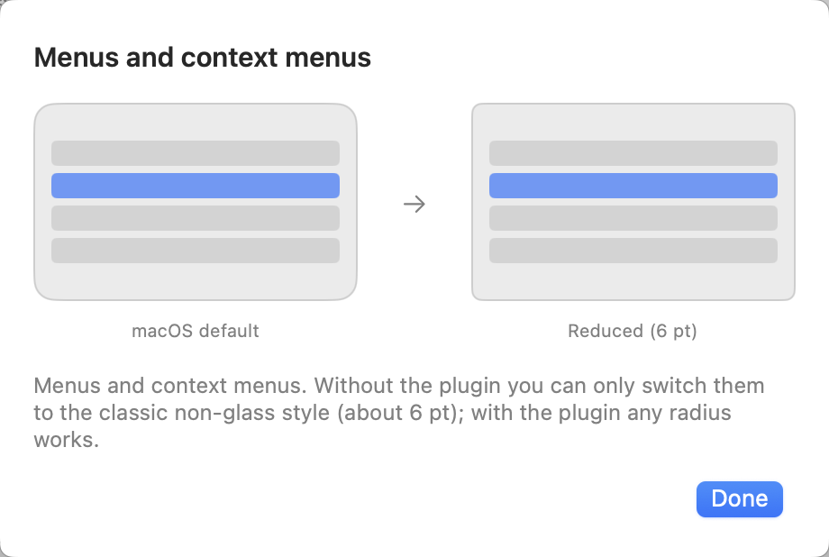
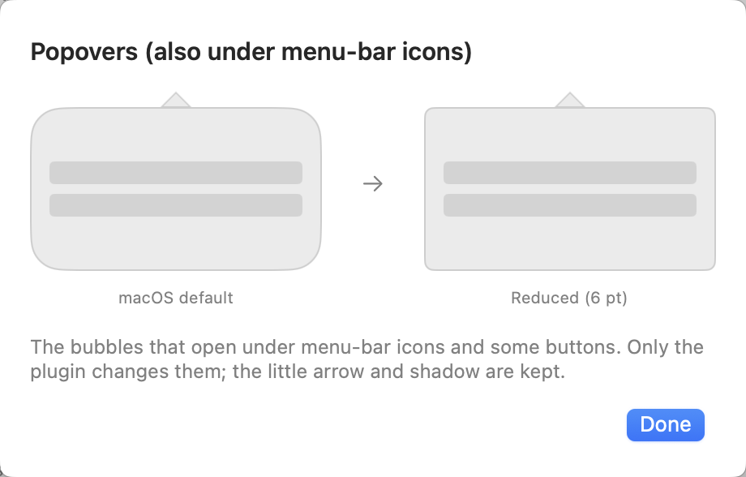
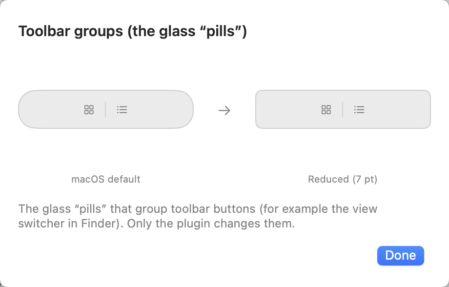
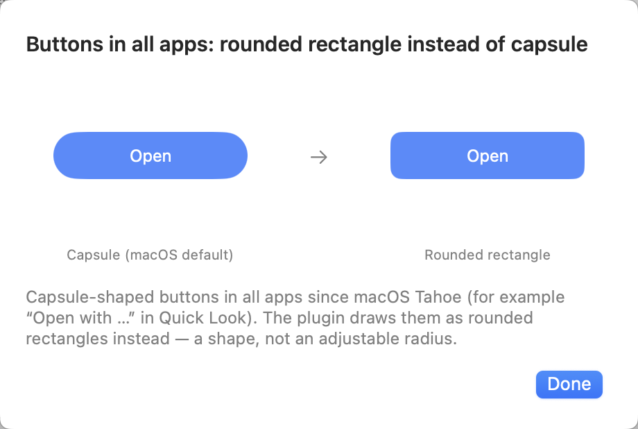
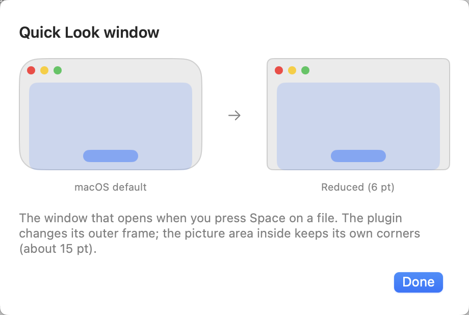
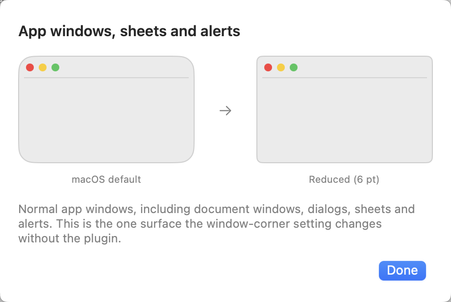
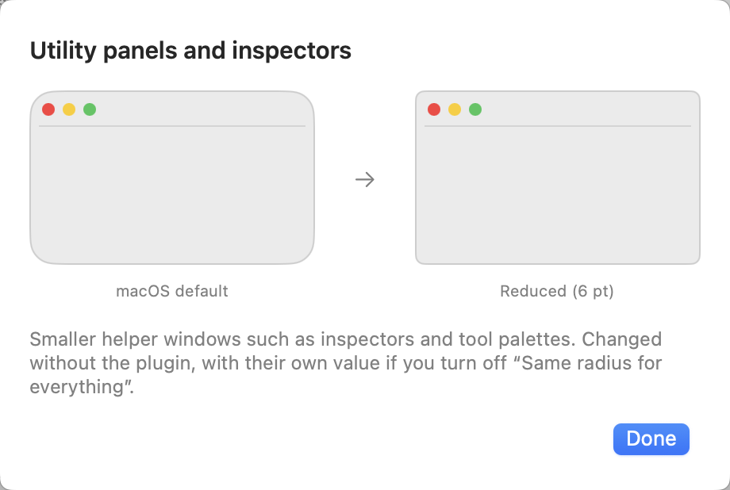
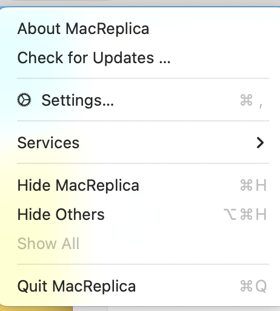

# Tools: Gatekeeper, macOS updates, window corners

The fourth option on MacReplica's start screen. Three independent tools for this Mac. Each one shows what it finds,
explains what a change would do, asks before anything changes, checks the real state afterwards and records the
change in a short history. None of them runs during an inventory, backup or restore, and none adds a permission for
users who don't open them.

Research date: 2026-10-13. Test Mac: macOS 27.0.1 (26A434, “Golden Gate”), Apple silicon, not enrolled in device
management. Version names: macOS 26 is Tahoe; macOS 27 is Golden Gate (released 2026-09-14, Apple silicon only; the
name and the board list come from the SOFA feed of the MacAdmins community and several news sites, not an apple.com
page).

## Architecture

| Layer | Where |
|---|---|
| Environment, capability states, verification, history | `Sources/MacReplicaCore/Tools/ToolKit.swift` (`ToolEnvironment`, `ToolCapability`, `ToolVerification`, `ToolOutcome`, `ToolHistoryStore` → `~/Library/Application Support/MacReplica/tools-history.json`) |
| Gatekeeper: state, per-app inspection | `Tools/GatekeeperTool.swift` |
| Software Update: settings, support status | `Tools/UpdatePreferencesTool.swift` |
| Profiles (Gatekeeper off, major-upgrade deferral) | `Tools/ConfigurationProfiles.swift` |
| Window corners | `Tools/WindowCornersTool.swift` |
| UI and flow (confirmation → change → re-read → history) | `Sources/MacReplica/App/AppModel+Tools.swift`, `Views/ToolsViews.swift` |

Capability states: Supported, Supported with limits, Experimental, Your step in System Settings, Needs administrator
password, Managed by your organisation, Not available on this macOS, Could not be determined.

The checks are fixed argument lists of allow-listed executables (`spctl`, `csrutil`, `profiles`, `codesign`,
`syspolicy_check`, `softwareupdate`), all read-only and without administrator rights. MacReplica never runs `sudo` for
these checks, never installs or removes a profile itself and never writes the Software Update settings: those steps are
the user's, in System Settings, where macOS asks for the password. What MacReplica writes, each only after the user
confirms it: the window-corner settings in the user's own preferences (and the plugin's settings), the `.mobileconfig`
files it prepares in its Application Support folder, an app's quarantine mark (removed or put back on request, see
below), and – for the corner plugin's one-click setup and undo only – the loader package (`installer`), the plugin file
and the loader's own files, with administrator rights through macOS's authentication dialog.

History entries hold: tool, change, previous and resulting state (machine-readable, no personal data), date, macOS
version, result, verification, and whether a revert is available.

## A. Gatekeeper and app security

Findings:
- `spctl --status` prints `assessments enabled`/`assessments disabled` (exit 1 when disabled) without administrator rights.
- Since macOS 15, `spctl --global-disable` only *reveals* “Anywhere” in Privacy & Security, and the user has to choose
  it there. Apple Developer News, 2024-08-06: https://developer.apple.com/news/?id=saqachfa. `man spctl` on 27 lists
  rule-database changes as “no longer supported”.
- A hand-installed profile with `com.apple.systempolicy.control` / `EnableAssessment = false` still turns assessments
  off on macOS 27. This was checked on the test Mac, which has such a profile from a third party. Its values are
  world-readable in `/Library/Managed Preferences/com.apple.systempolicy.control.plist`, with `_manualProfile = true`.
  Payload: https://developer.apple.com/documentation/devicemanagement/systempolicycontrol. Profiles can only be installed
  by the user in System Settings › General › Device Management (since macOS 11).
- `profiles -C`, `profiles status -type enrollment`, `csrutil status` and `system_profiler SPConfigurationProfileDataType`
  work without root. `profiles list -all` needs root and still exits 0.
- Per app: quarantine via `getxattr` (agent name stored with `\x20`), `codesign --verify --deep --strict`,
  `codesign -dv`, `codesign --verify -R=notarized` (online check; `stapler` needs Xcode),
  `spctl --assess --type execute -vv`, and `syspolicy_check distribution --json` on 14+, which exits 0 even with a fatal
  finding. When Gatekeeper is off, every verdict is `accepted` with `override=security disabled`; MacReplica shows
  this as “not checked”.
- The supported per-app route is “Open Anyway” in Privacy & Security, available for about an hour after a blocked launch
  (https://support.apple.com/en-us/102445). Removing the quarantine attribute skips Apple's first-launch malware check;
  MacReplica does it only on request for one app, after a warning, never for an app whose signature is damaged, and
  keeps the removed value so it can be put back.

What MacReplica does:
- Shows the state: Gatekeeper, the profile that sets it (a third-party one, MacReplica's own, or an organisation's), device
  management and SIP. It never confuses one app's quarantine with the global state.
- Checks one app and gives advice: opens normally / asks once / blocked → guided “Open Anyway” (opens the app and the
  pane, then re-checks) / damaged / not checked because Gatekeeper is off.
- On request, after a warning, it prepares **its own** profile `io.github.itsab1989.MacReplica.gatekeeper`. The user
  installs it, and MacReplica verifies it with `profiles -C` plus `spctl --status`. To turn checking back on, the user
  removes that profile only, and MacReplica verifies again. If another profile turns Gatekeeper off, MacReplica points to
  Device Management but neither touches that profile nor adds a second one. On a managed Mac it only shows the state.

| | 13 | 14 | 15 | 26 | 27 |
|---|---|---|---|---|---|
| Read state (`spctl`, profiles, SIP, enrolment) | yes | yes | yes | yes | **verified** |
| Per-app inspection | yes (no `syspolicy_check`) | yes | yes | yes | **verified** |
| “Open Anyway” route | yes (and Ctrl-click) | yes (and Ctrl-click) | only route | only route | only route |
| Gatekeeper-off profile, manual install | works | works | works | works (Oakley) | **works** (same payload on the test Mac) |

## B. macOS updates

Findings:
- The switches are in `/Library/Preferences/com.apple.SoftwareUpdate.plist` (world-readable, root-writable). Missing keys:
  check → on, download → on, install macOS updates → **off**, security/config data → on (compared with the
  27 UI). The 27 sheet has three switches; there is no “Check” switch and no App Store switch.
- Apple installs a new major version only after the user clicks “Upgrade” (update vs. upgrade:
  https://support.apple.com/en-us/108382). Risks: “Update all”, the list under “More info…”, and notification buttons.
- Major-upgrade deferral (`com.apple.applicationaccess` `forceDelayedMajorSoftwareUpdates` +
  `enforcedSoftwareUpdateMajorOSDeferredInstallDelay`, 1–90 days, per release):
  - Works with a hand-installed profile on 13–15.7.4.
  - From 15.7.5 there is one period for all updates, so security updates are delayed too.
  - 26 has a separate major period but deprecates the key.
  - **27 removed it.** Its successor (declarative `softwareupdate.settings`) needs supervised MDM.
  - Sources: https://developer.apple.com/documentation/devicemanagement/restrictions, https://support.apple.com/126206.
- There is no supported way to hide the upgrade badge or banner. `softwareupdate --ignore` is gone on 27.
- Support status: `softwareupdate --list-full-installers` (no root, asks Apple) lists the versions this Mac can install. A
  major version older than the three newest offered is reported as “probably no longer receives security updates”;
  Apple publishes no end dates.

What MacReplica does:
- Shows the switches and warns when security updates are off.
- Asks Apple about this version on request.
- Compares the switches with “stay on this version, stay secure” (download, install macOS updates, security on), opens
  Software Update and re-reads the plist afterwards. The result is “checked”, or “not done yet” with the missing switches.
- “Restore previous settings” goes back to the recorded state. It warns if that state has security updates off.
- On 13–15.7.4 and 26 it prepares its own deferral profile `io.github.itsab1989.MacReplica.defer-major-upgrades` (30,
  60 or 90 days, never more). It verifies the profile, the managed preference, and `Deferred: YES` in Apple's installer
  list when a newer version exists; otherwise the result is “partly checked”. On 15.7.5+ and 27 the option is not shown;
  the card explains why.

| | 13 | 14 | 15.0–15.7.4 | 15.7.5+ | 26 | 27 |
|---|---|---|---|---|---|---|
| Read switches | yes | yes | yes | yes | yes | **verified** |
| Guided change + re-read | yes | yes | yes | yes | yes | yes (simulated plist) |
| Deferral profile (≤ 90 days) | offered | offered | offered | not offered (delays security updates) | offered (deprecated) | **not possible** |
| Hide upgrade badge | no supported way in any version | | | | | |

## C. Window corners

Findings (all measured on 27.0.1 in throwaway test apps; values passed as launch arguments or into the test app's own
preference domain, so nothing on the Mac was changed; images in the validation folder):
- **`NSConvolutionOverride1`**: a private AppKit default, in AppKit's own strings. Its value is the corner radius in
  points of titled windows (`NSThemeFrame`), read in each app's process at launch. The default on 27 is 16 pt.

  Measured: 4 → ≈5 pt, 7 → ≈7 pt, 10 → ≈10 pt, 20 → ≈20 pt, 26 → ≈26 pt.
- **`NSConvolutionOverride2`**: the same for utility panels and inspectors.
- **`NSGlassMenusEnabled = NO`**: AppKit falls back to its older menu window without glass, with ≈6 pt corners instead of
  11.9 pt. This is a fixed style, not a radius, and the menu material changes too. It applies to context and pop-up menus
  and the menus of menu-bar items in AppKit apps.
- **Versions**: reported to work from 26.4 (TinkerTool 11.7). Earlier versions ignore it, and macOS 15 and older use about
  10 pt anyway.
- **No setting affects** popovers (≈20 pt), the Quick Look panel (≈20.5 pt), toolbar groups (capsules, radius = half the
  height) or capsule buttons (`NSButton.borderShape` automatic/capsule). These draw their own shapes.

  Tested without effect: `QLUseCGRoundedCorners`, `NSCornerRadius*`, `NSMenuUseGlassWindowStyle`,
  `NSPopoverUseSolariumGlassShadow`, `NSPopoverFrameCanEmbedContentInGlass`, `NSControlSolariumMetrics`,
  `NSControlFauxSolariumMetrics`, `NSButtonMayNeedLegacyAutomaticBezelStyleBehavior`, `NSSolariumEnabled`,
  `com.apple.SwiftUI.DisableSolarium`, and Reduce Transparency.
- **All of these surfaces are drawn inside each app's own process**, so code loaded into the app can change them:
  - Menus: `NSPopupMenuWindow` → glass `cornerRadius` and `_setCornerRadius:`.
  - Popovers and the Quick Look frame: `-[NSPopoverFrame _copyFrameMaskPathInRect:]`.
  - Toolbar groups: the glass view in `NSToolbarPlatterView` after layout.
  - Buttons: `borderShape` set to rounded rectangle.
- **The rounded picture area inside Quick Look** (≈15 pt) comes as an image from the protected `QuickLookUIService` and
  cannot be made smaller.

What MacReplica does (experimental, 26.4+ only; elsewhere the card says it isn't available and shows no controls):
- **Without anything else:**
  - one radius (2–24 pt) for app windows and for utility panels;
  - classic menus as a separate switch;
  - written to the user's global preferences through CFPreferences, the same as `defaults write -g`.
- **With the corner plugin** (behind a warning): its own radius for menus, popovers and toolbar groups, plus capsule
  buttons drawn as rounded rectangles, in apps that allow injection (not Safari/hardened apps). The Quick Look window
  is listed but does not visibly change on current macOS (Liquid Glass).
- **Radius per surface:** one radius for everything by default, or a separate radius per surface. Every surface can be
  left out.
- **One step for all keys:** one confirmation, one history entry with a snapshot of every key's exact previous value.
  “Restore previous” writes all of them back exactly; “Restore macOS default appearance” removes them all.

### The corner plugin (advanced, at the user's own risk)

`Extras/CornerPlugin/MacReplicaCorners.m` is built into the app as `Contents/Library/CornerPlugin/MacReplicaCorners.dylib`
(arm64 and arm64e), next to `MacReplicaCorners.dylib.options`. It is loaded by **Plugin Playground**, the maintained
tweak loader (github.com/CoreBedtime/playground; its predecessor Ammonia is archived and unlicensed). It exists for
Apple silicon only (its injector uses arm64 debug registers), so Intel Macs are shown as unsupported. Playground needs:
- System Integrity Protection only **partly** relaxed — debugging allowed (`csrutil enable --without debug` in
  recoveryOS), not a full `csrutil disable`. Only the user can do this; MacReplica never changes SIP.
- the loader installed (`PluginPlayground-1.1.0.pkg`, pinned by SHA-256 below): `/Applications/Plugin Playground.app`
  (its settings window), `/opt/pluginplayground/bin/grant` and `fangs`, `/opt/pluginplayground/tweaks/`.
- its **background service** running: the launch daemon `/Library/LaunchDaemons/com.pluginplayground.grant.plist`
  runs `grant`, which patches amfid for half a second, starts the injector `fangs` and restores amfid. `fangs` attaches
  to launchd and adds the tweaks to every *new* process (`DYLD_INSERT_LIBRARIES`); apps that were already open are not
  affected until they are reopened. No boot argument, no persisted library-validation change.
- on Apple silicon, `disablePAC = true` in `/opt/pluginplayground/current.options` (“Disable arm64e (PAC)” in
  Playground's window): without it, Apple's own arm64e apps (Finder, Safari, TextEdit …) never get the plugin. `fangs`
  re-reads the file whenever it changes.

**What went wrong in 1.1.0 (fixed in 1.1.1).** The one-click setup installed the loader and the plugin, then opened
Playground's window and told the user to “enable it”. That window has no such switch: enabling means clicking
**Install** in its *Daemon* box (which writes the daemon file and loads it) and **Save Global Changes** after ticking
“Disable arm64e (PAC)” – the tick alone is not saved, and the box is drawn ticked even when nothing is saved. On the
reporting Mac neither had happened, so the daemon file was missing, `fangs` was not running and `current.options` did
not exist; “Plugin Playground is enabled” correctly stayed grey, but nothing said what to click.

**How the setup works since 1.1.1.** MacReplica reads every requirement from the real system, never from the last
button pressed: `csrutil status`; the loader's programs; the daemon file; `launchctl print
system/com.pluginplayground.grant` (exit 0 loaded, 113 not loaded, anything else unknown); `pgrep -x fangs` (the only
proof the loader is active); `disablePAC` in `current.options`; the plugin files and their checksum against this copy
of MacReplica; and whether `MacReplicaCorners.dylib` is loaded in MacReplica's own process (`_dyld_get_image_name`) –
end-to-end proof that injection works. Unknown values show as a question mark, never as green. The status is read again
after every action, on **Check again**, and whenever MacReplica becomes the active app.

“Set up automatically…” (or “Finish setup automatically…” once the loader is there) runs only the steps that are still
missing, in one administrator prompt, and lists them before asking:
1. download the pinned package and verify its SHA-256 (nothing is installed on a mismatch), then `installer -pkg`;
2. `install` MacReplica's two plugin files into the tweaks folder;
3. `install` a `current.options` with `disablePAC = true` – every other key the user set is kept;
4. `mkdir -p /var/log/pluginplayground` and `install` the daemon file – byte-for-byte the definition Playground's own
   “Install” button writes (label, `grant`, `RunAtLoad`, `KeepAlive`, log paths; a test pins it);
5. `launchctl bootstrap system <daemon file>` – only if launchd does not already have the service loaded.

Afterwards it waits up to five seconds for `fangs` and checks each step against the real state (✓/✗ per step). A run
that is cancelled or fails keeps the finished steps, says which ones they are, and the next run only repeats what is
missing. If the service is loaded but `fangs` does not run, MacReplica shows launchd's last exit code and asks for a
restart; it never kills or restarts the injector itself. Each run is logged with an operation id, the macOS build and a
path-free one-line state (`readiness=… loader=… service=… loaded=… injector=… pac=… plugin=… active=…`).

**Undo** removes the plugin and uninstalls the loader (its app, `/opt/pluginplayground` including `current.options`, the
daemon file and logs) with fixed `rm -rf` commands on an allow-list; `rm` is refused for any other path. It does **not**
stop the running injector: launchd would end `grant` and its process group without letting `fangs` remove its hardware
breakpoints from launchd, which can crash the Mac. `fangs` only cleans up on SIGTERM to itself, and the restart that
turns SIP back on stops it anyway, so the panel says “restart” until then. No `nvram` or library-validation command is
ever run. The loader's project is unlicensed, so MacReplica only links to and downloads the official release — it
never forks, mirrors or bundles it; the pinned reference and the plugin's own interface are documented here so the
feature survives the loader changing.

Pinned loader: `PluginPlayground-1.1.0.pkg`, 1,186,472 bytes, SHA-256
`283c3b87e8861e158d726b3742e0bb42ea8d9677eaf9955eb541db88a7252b00`,
https://github.com/CoreBedtime/playground/releases/download/1.1.0/PluginPlayground-1.1.0.pkg.

Plugin interface (loader-agnostic): a dylib with a constructor (no special export) placed in the loader's tweaks
folder, injected via `DYLD_INSERT_LIBRARIES`. It reads the global defaults `MacReplicaMenuCornerRadius`,
`MacReplicaPopoverCornerRadius`, `MacReplicaQuickLookCornerRadius`, `MacReplicaToolbarCornerRadius` (2–24 pt) and
`MacReplicaRoundedButtons`. Its `MacReplicaCorners.dylib.options` plist (Playground's required sidecar) injects only
into AppKit processes and blacklists the system UI (`loginwindow`, `WindowManager`, `Dock`, `SystemUIServer`,
`ControlCenter`, `NotificationCenter`, `Spotlight`, `Setup Assistant`, `SecurityAgent`).

Safety design of the plugin:
- On macOS builds other than the tested ones (currently 26A434 = 27.0.1, a test keeps the Swift list and the plugin
  list identical) the plugin **still loads**, but MacReplica shows a warning and requires the user to acknowledge the
  risk before installing. Its per-method class/selector checks remain the real safety net.
- It only hooks what was chosen and never loads into the system UI processes above (`frameworkDependencies = AppKit`
  plus the blacklist).
- It checks every class and method before replacing it, and adds overrides only on the exact class.
- It catches exceptions around every change.

**What actually works, and what does not (measured on 27.0.1, 26A434, SIP fully off).** The loader injects ordinary
AppKit apps (Finder, Mail-type apps, MacReplica): menus, popovers, toolbar "pills" and capsule buttons all change when
the app is reopened. It does **not** reach:
- **Safari and other hardened Apple apps** — their code-signing refuses `DYLD_INSERT_LIBRARIES` outright (`plugin=0`,
  no crash). Nothing we ship changes this.
- **The Quick Look window** — on Tahoe the panel (`QLPreviewPanel`) is drawn with a Liquid Glass `NSGlassView`; setting
  the glass corner radius does not visibly change its outer frame, so the "Quick Look window" option is effectively a
  no-op on current macOS (the inner picture area, ~15 pt, was never changeable — it comes from `QuickLookUIService`).
- **System UI** (Dock, Control Center, menu bar) — blacklisted on purpose.

**The real cost of "Disable arm64e (PAC)" (`disablePAC = true`).** This is far more invasive than "a plugin in some
apps". Plugin Playground achieves arm64e injection by **running every arm64e app from an unsigned, PAC-/signature-
stripped copy under `/tmp/RuntimeApplications/`** — this happens to *all* arm64e GUI apps the loader sees, **not just
the ones our dylib targets** (observed: `Dock`, which our dylib blacklists, is still copied to `/tmp`). Consequences:
- The Mac's code signing is broadly bypassed while the loader runs; many of the user's apps run unsigned from `/tmp`.
- Apps with strict code-signing are **SIGKILLed** when our dylib is inserted (`CODESIGNING, Invalid Page`). Confirmed:
  **Microsoft AutoUpdate** crash-loops; it is in the shipped blacklist. Our per-tweak blacklist stops *our dylib* from
  loading (which fixes that crash), but it does **not** stop the loader's `/tmp` stripping — only turning the PAC
  setting off, pausing injection, or uninstalling the loader does.
- Apps that verify their own install location misbehave — e.g. **Little Snitch** shows "must be installed in
  Applications" because its GUI was launched from the `/tmp` copy (the firewall daemon itself, arm64, is untouched).
- Known-fragile apps can be added to `blacklistedApps` in `MacReplicaCorners.dylib.options`, or to Plugin Playground's
  global blacklist in its configurator.

Because of this, MacReplica's setup confirmation, the panel, the help text and the user guide now state plainly that
enabling the PAC setting runs arm64e apps from unsigned `/tmp` copies and can crash or break some of them.

**SIP level.** The loader's README and MacReplica's steps ask for partial SIP (`csrutil enable --without debug`). On
macOS 27.0.1 that is **not sufficient** — the injector (`fangs`, ad-hoc signed with restricted entitlements) is killed
by AMFI even with debugging allowed; only full `csrutil disable` let it run in testing. MacReplica keeps the partial
instruction (the smaller change) but warns that recent macOS may need full `csrutil disable`, and its injector-running
check correctly shows red when the loader cannot actually inject. See the compatibility issue filed upstream.

Costs while the loader is enabled: the Mac's security is broadly weaker (see above) and a crash in a loaded plugin, or
in a PAC-stripped app, affects that app. Recovery is always possible by removing the plugin and uninstalling the loader
(in MacReplica, or by hand) and turning System Integrity Protection fully back on, which also stops all loading and the
`/tmp` stripping.

Measured in the test app with the real plugin (menu / popover / Quick Look):

| Setting | Menu | Popover | Quick Look |
|---|---|---|---|
| Plugin without settings | 11.9 pt | 20.5 pt | 20.5 pt (unchanged) |
| Shared radius 6 | ≈6.8 pt | ≈6.8 pt | ≈6.8 pt |
| Separate radii 4 / 10 / 16 | ≈5.1 pt | ≈10.2 pt | ≈17.1 pt |

Further results:
- Toolbar group 18 → 7 pt; the large capsule button and Quick Look's “Open with …” became rounded rectangles.
- On a real Apple app with the loader enabled (SIP off) on 27.0.1: **Finder** toolbar pills and buttons became rounded
  rectangles, and menus/popovers took the chosen radius. **Safari** was not affected (injection refused). The **Quick
  Look window** outer frame did not change (Liquid Glass).

### Showcase

Built-in before/after explainers (one per surface) and real screenshots, in `docs/images/corner-plugin/`:

| | |
|---|---|
| Menus |  |
| Popovers |  |
| Toolbar groups |  |
| Buttons |  |
| Quick Look |  |
| App windows |  |
| Utility panels |  |

Real, with the plugin active (macOS 27.0.1, SIP off): Finder toolbar (pills → rounded rectangles) and a real menu:

| | 13–15 | 26.0–26.3 | 26.4+ | 27 |
|---|---|---|---|---|
| Windows / panels (no plugin) | no (not needed) | no (key ignored) | experimental (reported, not tested here) | experimental, **verified visually** |
| Classic menus (no plugin) | – | not tested | not tested | **verified in test app** |
| Plugin surfaces | – | – | plugin inactive (untested builds) | **verified in test app** (26A434) |
| Relaunch needed | – | – | apps | apps |
| Survives macOS update | – | – | not guaranteed | not guaranteed; the plugin switches itself off |
| Revert | – | – | exact previous values | exact previous values |

## Verification (2026-10-13)

| Capability | Status | Evidence |
|---|---|---|
| Tools as the fourth start option, all three cards, 7 languages | Verified | Real app on screen; localisation tests |
| Gatekeeper state incl. third-party profile | Verified | Real macOS 27 state on screen: “off”, “a configuration profile you installed” |
| Per-app inspection | Verified | IINA on screen: signature, notarised (online), quarantine by Homebrew Cask, “not checked – Gatekeeper is off” |
| “Open Anyway” guidance | Not verified | Needs a blocked app with Gatekeeper on, and the user's password; the test Mac has Gatekeeper off |
| Gatekeeper-off profile: prepare, install, verify, remove, verify | Simulated | Stand-ins for `profiles`/`spctl` on a simulated 27 Mac; generated payload checked. The same payload works on the real test Mac (third-party profile) |
| Update switches | Verified | Real plist on 27 matches the System Settings sheet |
| Support status | Verified | Real Apple installer list: simulated 14.8.4 → “probably no longer…”, update 14.8.9 available |
| Guided update change, “not done yet” → “checked”, revert | Simulated | Sandbox plist changed between checks, standing in for the user's change |
| Deferral profile on 26 (Intel) | Simulated | Stand-ins; “partly checked” because nothing newer is offered to an Intel Mac |
| Deferral on 27 | Unsupported | Apple removed the key; the card says so and shows no button |
| Corner setting: write → read back → visual → exact revert | Verified | MacReplica's write path into a test app's own domain via cfprefsd; real window 7 px → 13 px corner run (≈5 pt → ≈7 pt) |
| Corner tool in the app UI | Simulated | Sandbox preference file on a simulated 27 Mac (apply 10/10, revert to “not set”) |
| Classic menus key | Verified (test app) | 11.9 → 6.8 pt in a test app; not tested system-wide (would change the user's settings) |
| Corner tool UI: shared/separate radius, each surface on/off, apply, exact revert | Simulated | Sandbox preference file on a simulated 27 Mac |
| Corner plugin: menus, popovers, Quick Look, toolbar groups, buttons | Verified (test app) | Real plugin injected into a throwaway app: measured radii above; inert on an untested build |
| Corner plugin: download, install / remove, requirements | Simulated + verified download | Real pinned loader download + checksum verified; install/remove/uninstall via stand-in `csrutil` and a sandbox loader folder; graceful fallback when the download fails, confirmed on screen |
| Corner plugin in Finder, Safari, other apps | Not verified | Needs Plugin Playground enabled with partial SIP on the test Mac |
| Quick Look picture area | Unsupported | Drawn by QuickLookUIService (≈15 pt) |
| Corners on 26.4–26.x | Not verified | Reported by TinkerTool; no 26.4 Mac available |
| Gatekeeper: open app, remove/restore quarantine of one app | Verified | Throwaway app on screen: mark removed, put back byte for byte, app opened (translocated while quarantined) |

Nothing in these tests changed the test Mac's Gatekeeper, update or appearance settings. The global corner value (7, set
by the user before) was read but never written.

## Verification addendum (2026-10-16, 1.1.1)

The corner plugin was finally run with the real loader on a real Mac (macOS 27.0.1 / 26A434, M3 Max), SIP fully
disabled. This supersedes the "test app" rows above for the plugin:

| Capability | Status | Evidence |
|---|---|---|
| Automatic setup (download → install → PAC setting → service → start) | Verified | All seven status rows green incl. "loaded in MacReplica"; `fangs` running; `lsof`/`vmmap` show the dylib in Finder and MacReplica |
| Partial SIP sufficient | **Disproved** | `csrutil enable --without debug` → AMFI SIGKILLs `fangs` (restricted entitlements); only full `csrutil disable` worked |
| Menus, popovers, toolbar pills, buttons in Finder | Verified | Finder reopened with the loader active: pills/buttons → rounded rectangles, menus/popovers → chosen radius (screenshots in `docs/images/corner-plugin/`) |
| Buttons in Safari / iMessage | **Does not work** | Safari and Messages refuse injection (hardened runtime); `plugin=0`, no effect |
| Quick Look window | **Does not work** on 27 | Panel is `QLPreviewPanel` with a Liquid Glass `NSGlassView`; outer frame keeps its corners (diagnosed via an injected logging build) |
| PAC-stripping side effects | Confirmed | Loader runs all arm64e apps from `/tmp/RuntimeApplications/`; Microsoft AutoUpdate crash-loops (`CODESIGNING, Invalid Page`) and is blacklisted; Little Snitch GUI showed "must be in Applications" |
| Undo + receipt forget | Verified | App, `/opt/pluginplayground`, daemon, logs and the `pkgutil` receipt all removed |

Untested-build behaviour, the acknowledgement gate, and the "not installed" state were verified on screen (a simulated
build `26Z999`). The real-Mac loader was left **paused** after testing and is removed entirely at the end of the work.
